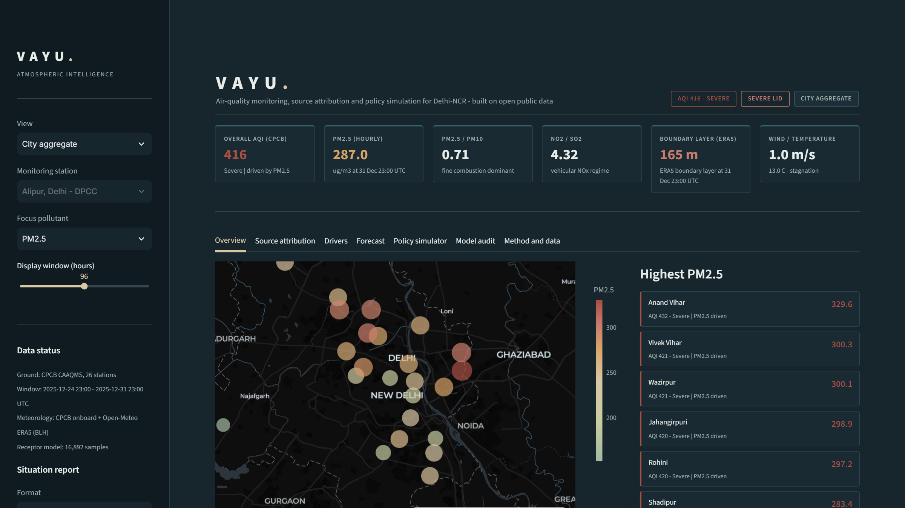
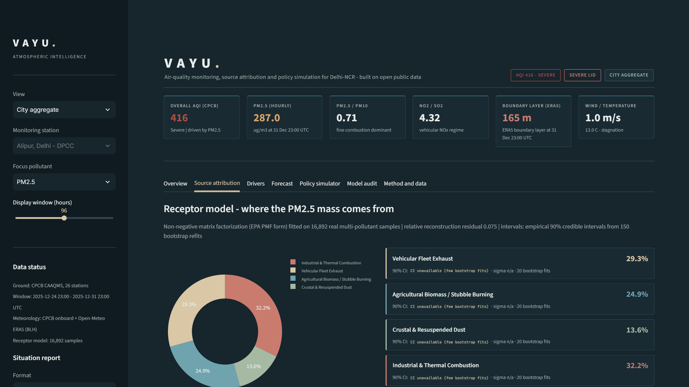
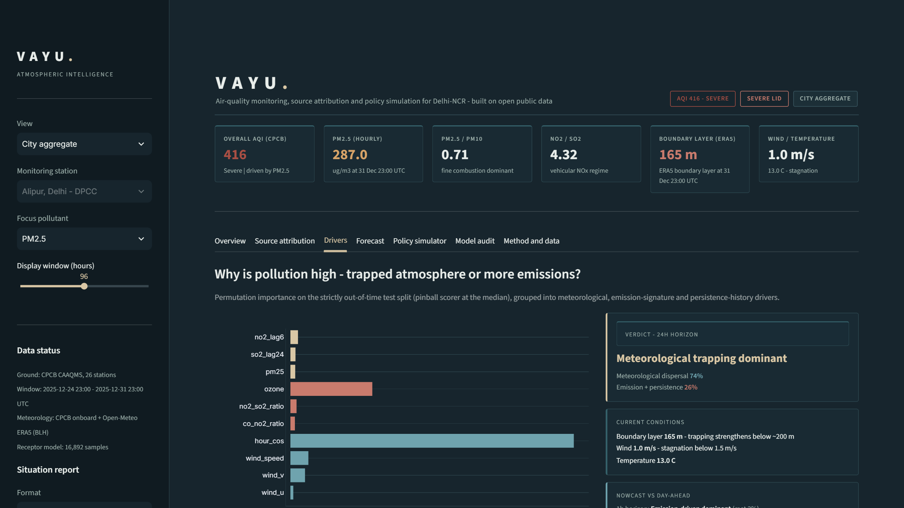
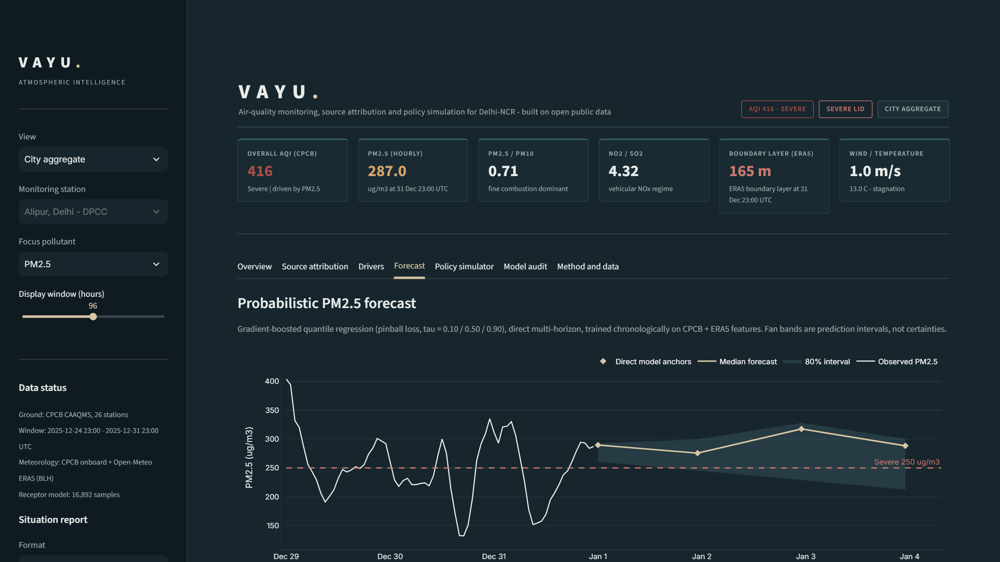
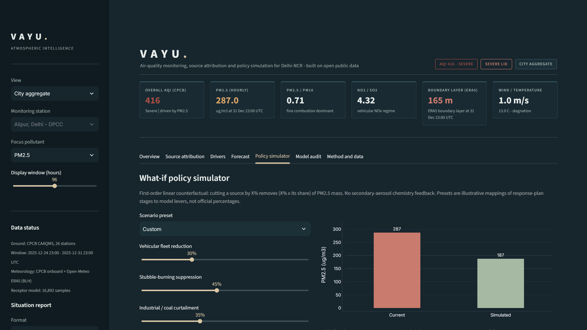
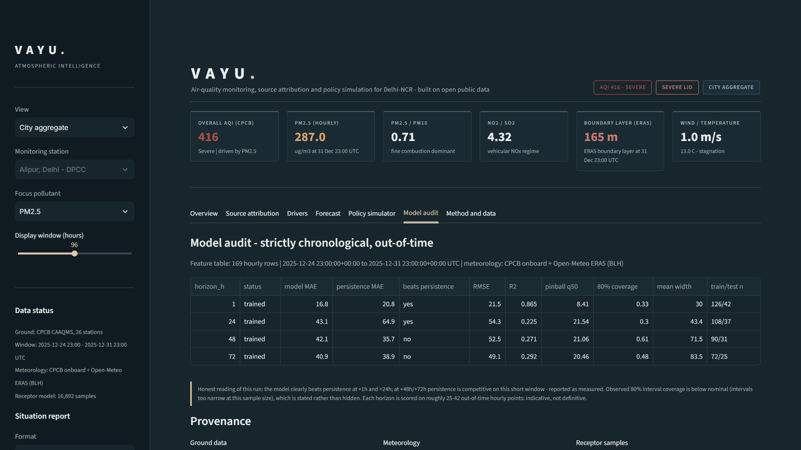
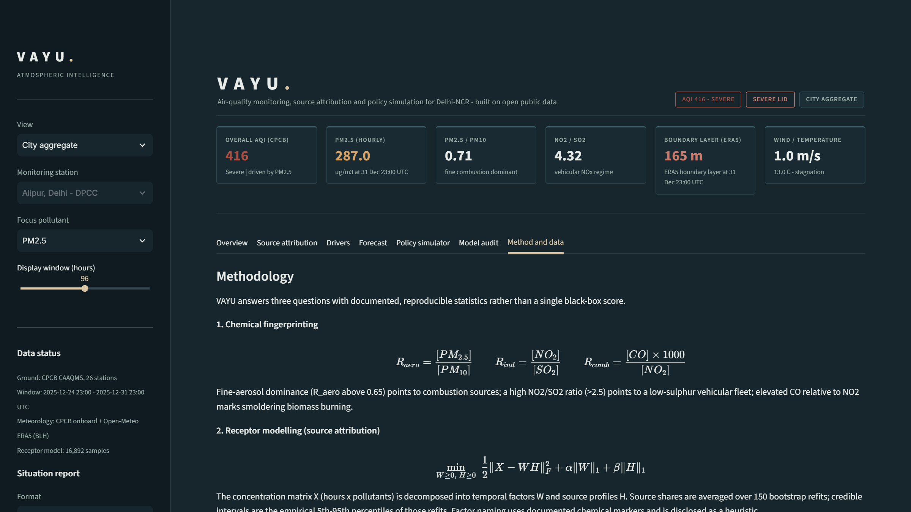
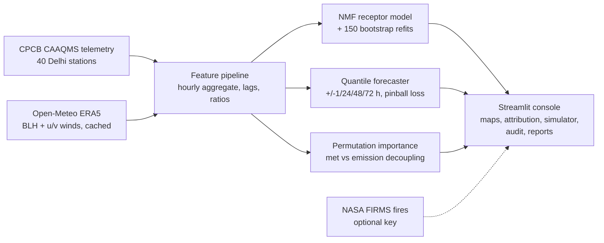

<div align="center">

# VAYU.

**Atmospheric intelligence for Delhi-NCR — source attribution, probabilistic forecasting and policy simulation on open public data.**

[](https://github.com/USERNAME/vayu/actions/workflows/tests.yml)


*Understand the air. Trace the source. Quantify the uncertainty.*

</div>

---

## Contents
1. [Problem](#1-problem)
2. [What VAYU does](#2-what-vayu-does)
3. [Screenshots](#3-screenshots)
4. [Methodology](#4-methodology)
5. [Results (measured, not asserted)](#5-results-measured-not-asserted)
6. [Architecture](#6-architecture)
7. [Tech stack and data sources](#7-tech-stack-and-data-sources)
8. [Setup and running](#8-setup-and-running)
9. [Limitations and intended use](#9-limitations-and-intended-use)
10. [AI tools used](#10-ai-tools-used)
11. [Team](#11-team)

---

## 1. Problem

Every winter the Indo-Gangetic Plain experiences hazardous smog episodes, and Delhi-NCR sits at its centre. Standard dashboards report **what** the concentration is, but not three questions that actually matter for public health response and governance:

1. **Where is the PM2.5 coming from?** Vehicular exhaust, industrial combustion, agricultural biomass burning and dust coexist in the same air; a single number cannot separate them.
2. **Is a spike caused by more emissions, or by the atmosphere trapping normal emissions?** When the planetary boundary layer collapses to ~150 m at night in winter, pollution rises with no change in human activity. Confusing the two leads to the wrong policy response.
3. **What happens if a specific intervention is applied?** Regulators need to compare the expected effect of traffic restrictions vs. dust control *before* enforcement.

Ground sensors cannot answer these directly: they measure pollutant mass, not source labels. Supervised classifiers trained on invented "source" labels are scientifically meaningless — VAYU takes the unsupervised, uncertainty-quantified route instead.

## 2. What VAYU does

- **Source attribution** — a non-negative matrix factorization receptor model (the same mathematical form as the US EPA's PMF5) decomposes multi-pollutant chemistry into four factors (traffic, industry, biomass burning, dust), with **bootstrap credible intervals** on every share.
- **Inversion vs. emission decoupling** — permutation importance on a strictly out-of-time test split separates *meteorological trapping* (boundary-layer height, calm winds) from *emission and persistence* signals.
- **Probabilistic forecasting** — gradient-boosted quantile regression (pinball loss, τ = 0.10/0.50/0.90) at +1/24/48/72 h horizons, evaluated strictly chronologically and always benchmarked against a persistence baseline — including where the baseline wins.
- **Policy simulator** — a first-order counterfactual engine with illustrative response-stage presets for comparing intervention sizes.
- **CPCB AQI computation** — official 2014 sub-index breakpoints, per station and city-wide, with the driving pollutant reported.
- **Situation reports** — print-ready HTML/Markdown reports generated from live engine state; CSV export of the modelling table.
- **Honest failure reporting** — when a dataset is unavailable (e.g. NASA FIRMS without an API key, a weather-API outage), the UI says *unavailable*. It never fabricates values.

## 3. Screenshots

| Overview — hotspots, AQI, boundary layer | Source attribution — NMF with bootstrap CIs |
|---|---|
|  |  |

| Drivers — inversion vs. emissions | Forecast — quantile fan chart |
|---|---|
|  |  |

| Policy simulator | Model audit — out-of-time metrics |
|---|---|
|  |  |

| Method and data |
|---|
|  |

## 4. Methodology

### Chemical fingerprinting
Diagnostic ratios characterise the pollution regime:

$$R_{aero} = \frac{[PM_{2.5}]}{[PM_{10}]}, \qquad R_{ind} = \frac{[NO_2]}{[SO_2]}, \qquad R_{comb} = \frac{[CO]\times 1000}{[NO_2]}$$

Fine-aerosol dominance (R_aero > 0.65) indicates combustion; a high NO2/SO2 ratio (> 2.5) indicates a low-sulphur vehicular fleet; elevated CO relative to NO2 marks smoldering biomass. **Measured real medians on this dataset: 0.68, 4.31, 35.6.**

### Receptor model (source attribution)
$$\min_{W \ge 0,\; H \ge 0} \; \tfrac{1}{2}\lVert X - WH \rVert_F^2 + \alpha \lVert W \rVert_1 + \beta \lVert H \rVert_1$$

X (hours × pollutants) decomposes into temporal factors W and source profiles H. Shares are averaged over **150 bootstrap refits**; credible intervals are the empirical 5th–95th percentiles. Factor naming uses documented chemical markers and is disclosed as a heuristic in the UI.

### Quantile forecasting
$$L_\tau(y, \hat{y}) = \max\left(\tau\,(y-\hat{y}),\; (\tau-1)(y-\hat{y})\right), \quad \tau \in \{0.10, 0.50, 0.90\}$$

Direct multi-horizon gradient-boosted models use only information available at forecast time (lags, rolling means, chemical ratios, onboard met sensors, ERA5 boundary-layer height and u/v winds). Splits are strictly chronological; quantile crossing is corrected by sorting.

### Driver separation
Permutation importance on the out-of-time test split (pinball scorer at the median), grouped into *meteorological dispersal*, *emission signature* and *persistence history*.

## 5. Results (measured, not asserted)

**Attribution** — NMF on 16,892 real samples; relative reconstruction residual 0.075; shares from 150 bootstrap refits:

| Source (heuristic assignment) | Share | 90% CI |
|---|---|---|
| Industrial & thermal combustion | 32.4% | [29.8, 33.8] |
| Vehicular fleet exhaust | 30.0% | [28.5, 37.9] |
| Agricultural biomass / stubble burning | 24.2% | [21.3, 25.7] |
| Crustal & resuspended dust | 13.4% | [10.8, 14.1] |

**Forecasting** — 169 hourly city-aggregate rows (2025-12-24 → 12-31 UTC, 40 stations); chronological 75/25 split; persistence = "predict last observed PM2.5":

| Horizon | Model MAE | Persistence MAE | Beats baseline | R² | 80% coverage |
|---|---|---|---|---|---|
| +1 h | **16.8 µg/m³** | 20.8 | yes | **0.865** | 0.33 |
| +24 h | **43.1 µg/m³** | 64.9 | yes | 0.225 | 0.30 |
| +48 h | 42.1 µg/m³ | 35.7 | **no — persistence wins** | 0.271 | 0.61 |
| +72 h | 40.9 µg/m³ | 38.9 | **no — persistence wins** | 0.292 | 0.48 |

> **Honest reading:** VAYU clearly beats persistence at nowcast and day-ahead ranges; at +48/+72 h on this short window persistence is competitive — reported as measured. Observed interval coverage is below nominal (intervals too narrow at ~7 days of data), and the audit tab states this. Each horizon is scored on ~25–42 out-of-time hourly points: indicative, not definitive.

**Driver separation (this window):** the 24 h horizon is meteorological-trapping dominant (74%), while the 1 h nowcast is emission-signal dominant (86%).

**Test suite:** 39 pytest tests covering AQI breakpoints, ratio edge cases, NMF constraints, quantile monotonicity, chronological-split leakage checks and simulator bounds.

## 6. Architecture



Engine code is separated from presentation: `src/ingestion` (data), `src/features` (pipeline + AQI), `src/models` (forecaster + explainer), `src/attribution` (NMF + simulator), `src/reports` (document generation). Every figure shown in the UI is computed live from these modules — nothing is hard-coded.

## 7. Tech stack and data sources

- **Python 3.10+** · pandas · NumPy · scikit-learn (NMF, HistGradientBoosting, permutation importance) · pyarrow
- **Streamlit** + **Plotly** (MapLibre dark basemap) for the console
- **pytest** for the test suite · **GitHub Actions** CI (Python 3.12/3.13)

| Data | Source | Notes |
|---|---|---|
| Ground telemetry | CPCB CAAQMS via open mirror `Vonter/india-cpcb-aqi` | 26,895 records, 40 Delhi-NCR stations, 15-min cadence |
| Meteorology | Open-Meteo ERA5 archive API | hourly BLH, winds, T/RH/pressure; local cache; provenance shown in UI |
| Active fires | NASA FIRMS VIIRS | optional (`FIRMS_MAP_KEY`); reports "unavailable" without a key |
| AQI methodology | CPCB National AQI (2014) | sub-index breakpoints with linear interpolation |

## 8. Setup and running

```bash
# 1. Clone
git clone https://github.com/<your-username>/vayu.git
cd vayu

# 2. Environment (Python 3.10+)
python -m venv venv
.\venv\Scripts\activate          # Windows
pip install -r requirements.txt

# 3. Data (real CPCB download -> Delhi slice; skipped if already present)
python src/ingestion/download_cpcb_delhi.py

# 4. Test suite (offline, no API keys needed)
pytest tests/ -v

# 5. Console (fetches ERA5 weather once, then caches; works offline)
streamlit run app/streamlit_app.py
```

Open `http://localhost:8501`. The engine computes features, the NMF bootstrap, quantile models and driver analysis on first load (one-time, cached for the session). **Offline behaviour:** with no network, VAYU uses the cached weather and proceeds on CPCB's onboard met sensors, displaying missing items as "unavailable" rather than estimating them.

## 9. Limitations and intended use

- Attribution shares are statistical evidence about co-varying pollutants — **not** a measured emissions inventory and **not** causal proof.
- The open CPCB mirror provides a ~one-week rolling window; a longer archive would strengthen multi-week validation (interval coverage is below nominal at this sample size — shown in the audit tab).
- The policy simulator is a documented **first-order linear counterfactual** without secondary-aerosol chemistry.
- All values are model estimates with stated uncertainty — not probabilities and not regulatory determinations.
- Intended for situational awareness, prioritisation and planning support; confirmatory decisions require measurement campaigns.

## 10. AI tools used

Per hackathon rules: AI assistants were used for ideation, scaffolding and engineering support (**Antigravity by Google** for early prototyping; **OpenCode (GLM)** for pipeline engineering, testing, UI and documentation). All models are trained and evaluated on real open datasets; every metric in this README is reproducible via `pytest tests/ -v` and the app's Model audit tab.

## 11. Team

| | |
|---|---|
| **Team** | VAYU |
| **Members** | Adya Sinha |
| **Track** | Green Planet — GP-01: Air Quality Monitoring & Source Attribution |
| **Live demo** | *(add Streamlit Community Cloud URL after deployment)* |

---

<div align="center">
<sub>VAYU · open data: CPCB CAAQMS, Open-Meteo ERA5, CPCB AQI methodology · estimates carry stated uncertainty and are subject to revision</sub>
</div>
